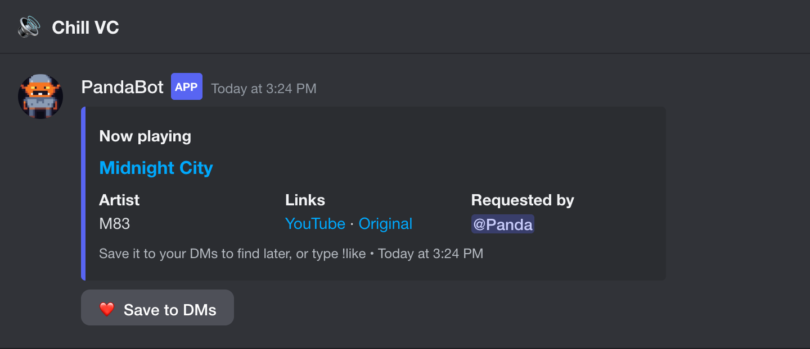
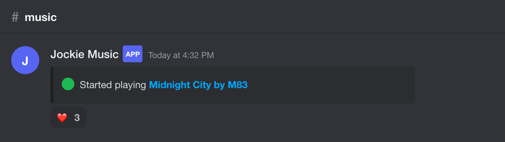
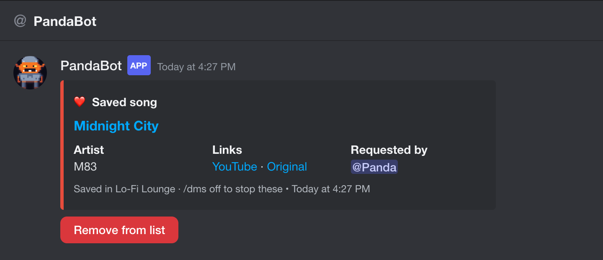
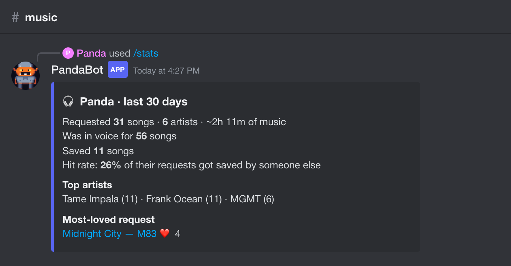
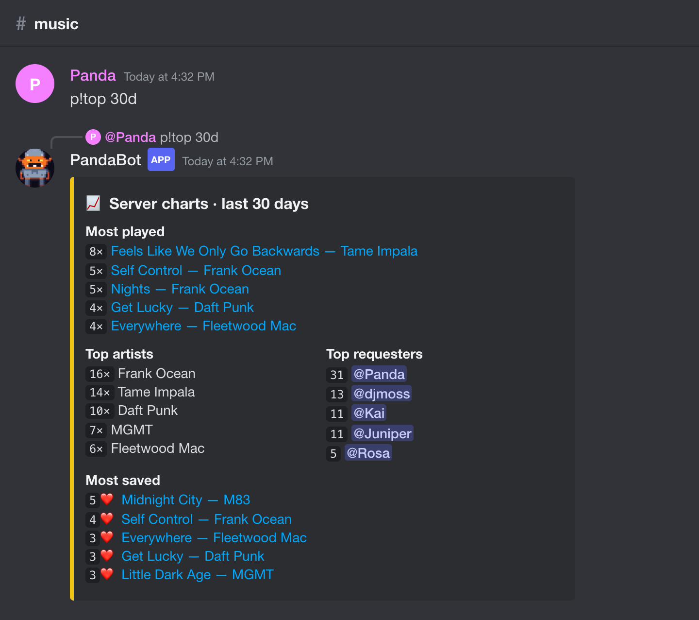
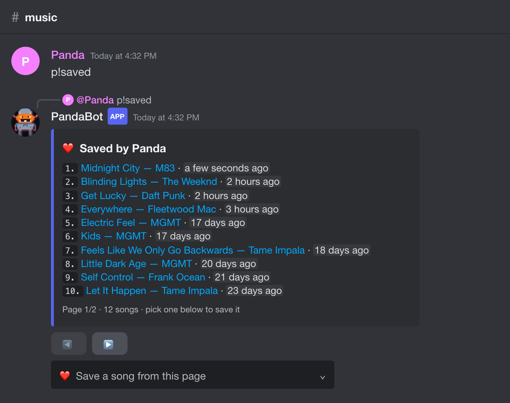
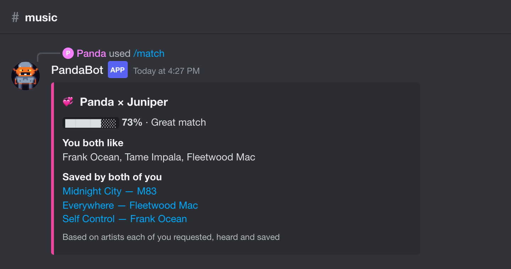
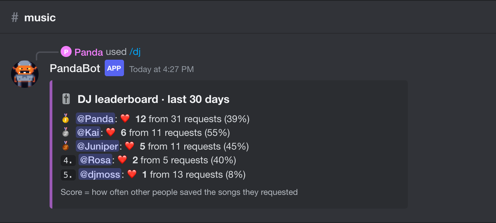
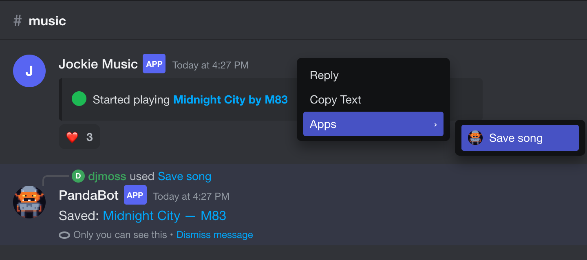

# 🐼 PandaBot

**A Discord companion for Jockie Music.** Never lose a song you heard in voice chat again.

[**➕ Add to Discord**](https://discord.com/oauth2/authorize?client_id=1568403551665782835&scope=bot+applications.commands&permissions=117824)
· [Website](https://pandabot-site.onrender.com)
· [Support server](https://discord.gg/vvShzeYx5E)
· [Privacy](https://pandabot-site.onrender.com/privacy.html)
· [Every command, with screenshots](https://pandabot-site.onrender.com/commands.html)



Music bots like Jockie play songs in voice channels, but once a song ends it's gone. PandaBot
follows the music bot and adds the missing pieces:

- **🎧 Now-playing cards** in the voice channel's own chat: title, artist, who requested it, and a YouTube link.
- **❤️ One-tap saving.** Tap the heart, press **Save to DMs**, type `!like`, or `/save`. Each save is DMed to you,
  so your DMs become your playlist. Unsaving deletes the card.
- **📊 Stats:** music profiles (`p!stats`), server charts (`p!top`), a "whose picks get saved most"
  leaderboard (`p!dj`), taste matching (`p!match @friend`), and `p!heard` for "what was that song?"
- **📚 Backfill:** reads a server's old music-bot messages so the stats start with months of history.
- **🔌 Other music bots** via `/musicbot add`, with `/musicbot check` to see how each bot's messages are read.

PandaBot never joins voice or plays music. It only reads what the music bot posts.

**There's nothing to set up for Jockie.** Add PandaBot, play a song with Jockie (any Jockie instance),
and the card appears in that voice channel's chat. PandaBot just needs to see the channels where people
type `m!p` and where Jockie posts; `/setupcheck` lists any it can't. `/musicbot add` is only for
other music bots.

## Screenshots

<table>
<tr><td width="50%" valign="top"><br><sub>Tap ❤️ on the music bot's post (or type <code>!like</code>) to save the song</sub></td><td width="50%" valign="top"><br><sub>Every save lands in your DMs</sub></td></tr>
<tr><td width="50%" valign="top"><br><sub><code>p!stats</code>: someone's music profile</sub></td><td width="50%" valign="top"><br><sub><code>p!top</code>: server charts</sub></td></tr>
<tr><td width="50%" valign="top"><br><sub><code>p!saved</code>: your saved songs, with paging</sub></td><td width="50%" valign="top"><br><sub><code>p!match @friend</code>: taste match</sub></td></tr>
<tr><td width="50%" valign="top"><br><sub><code>p!dj</code>: whose picks get saved most</sub></td><td width="50%" valign="top"><br><sub>Right-click any old song → Apps → Save song</sub></td></tr>
</table>

Every command, with a screenshot: **[pandabot-site.onrender.com/commands.html](https://pandabot-site.onrender.com/commands.html)**. They're generated from the real reply code by `tools/screenshots.py`, using a made-up demo server.

## How it's built

| | |
|---|---|
| Language | Python 3.12, [discord.py](https://github.com/Rapptz/discord.py) 2.x (gateway bot, slash commands, buttons, select menus) |
| Storage | SQLite (play history, saves, listeners, settings), with in-place schema upgrades |
| Hosting | Render background worker + persistent disk; auto-deploys on push. Website is a Render static site (`site/`) |
| Tests | 71 pytest tests, including captured real Jockie messages and end-to-end handler tests with fake Discord objects |
| Screenshots | `tools/screenshots.py` runs every command through the real handlers on a made-up demo server and photographs the replies in Discord's style with headless Chrome (`pip install playwright`, then run it) |

```
jockie_companion/
  parser.py   music-bot message → Track (title, artist, link, requester, length); no Discord dependency
  db.py       SQLite store: plays, likes, listeners, settings, stats queries, /forgetme
  stats.py    time periods, stat cards, paged song lists with a "save from this page" menu
  bot.py      Discord events, saving/DM cards, announcements, p! and slash commands, backfill
```

The parser deliberately works on plain snapshots rather than discord.py objects, so each real
music-bot format gets a regression test (see `tests/test_parser.py`).

## Self-hosting

You'll need your own bot application and token (see [Setup](#setup-about-10-minutes) below).
The code is licensed under the **GNU AGPL-3.0**: you can run and modify it, but if you run a modified
version for other people, you must share your changes under the same license.

## Ways to save a song

| How | Where |
|---|---|
| Tap ❤️ (tap again to unsave) | Jockie's "Started playing", or Jockie's "Added Track" (saves that queued song). A ❤️ you add to PandaBot's card works too |
| **Save to DMs** button | PandaBot's now-playing card, or `/nowplaying` |
| Type `!like` | Any channel |
| Type just `❤️` | Voice-channel chat, the announce channel, or any channel Jockie posts in |
| `/save` | Any channel |
| Right-click a message → Apps → **Save song** | Any older Jockie message |

`!like`, ❤️ messages and `/save` save what's playing now. If you're in a voice channel, that's
the song playing **in your channel**, even when several Jockie instances play in different channels.

## Stats and history

Type these in any channel, or use the slash command with the same name (e.g. `/stats`).
Every song list has ◀ ▶ paging and a **❤️ Save a song from this page** menu.

| Text command | What it shows |
|---|---|
| `p!stats [@user] [period]` | Music profile: requests, artists, listening time, top artists, most-loved request, hit rate |
| `p!played [@user] [period]` | Everything they requested |
| `p!panda 7d` | Same, by name: any name of someone who has requested songs |
| `p!saved [@user]` | Their saved songs |
| `p!heard [period]` | Songs that played while you were in voice ("what was that song?") |
| `p!history [period]` | Everything played in the server |
| `p!top [period]` | Server charts: most played, top artists, top requesters, most saved |
| `p!dj [period]` | Leaderboard of whose requests other people save most |
| `p!match @user [@user]` | Taste match based on artists requested, heard and saved |
| `p!throwback` | A random song from the past, with a Save button |
| `p!backfill [messages]` | *(Manage Server)* Read old messages to log Jockie's past plays (default: last 2,000 per channel; e.g. `p!backfill 10000`) |
| `p!support` | Ko-fi link to help cover hosting |
| `p!invite` | Link to add PandaBot to another server |
| `p!help` | This list |

**Periods:** `24h`, `7d`, `2w`, `3m` (months), `1y`, `today`, `week`, `month`, `all`.
Defaults: stats/dj 30 days, played/top 7 days, heard/history 24 hours.

**Good to know:** "heard" and listening time only count from when PandaBot started
watching. Backfilled songs have the title, artist and time, but only sometimes the
requester. Song length comes from Jockie's "Added Track" message, so songs that started
straight away (empty queue) have no length.

## Other commands

| Command | What it does |
|---|---|
| `!like` or `/save` | Save the current song (`!like` works in any channel) |
| `/nowplaying` | Show the current song with a Save button |
| `p!saved [@user]` or `/likes [member] [public]` | Saved songs, paged |
| `/unlike <number>` | Remove a song by its number in `p!saved` (and its DM card) |
| `/export` | Download your saved songs as a CSV |
| `/dms <on/off>` | Turn the DM card on save on or off for yourself |
| `/announce [mode] [channel]` | *(Manage Server)* `follow` Jockie's voice chat, a fixed `channel`, or `off` |
| `/setupcheck` | *(Manage Server)* Channels the bot can't see or post in |

## Setup (about 10 minutes)

You need your own bot account. It's free, and it's the only ToS-safe way to read a
channel automatically. Scraping with your personal account (a "self-bot") can get
the account banned.

1. **Create the bot.** Go to <https://discord.com/developers/applications> →
   **New Application** → name it. Then open **Bot**:
   - Click **Reset Token**, copy the token, and keep it private.
   - Under **Privileged Gateway Intents**, turn on **Message Content Intent**.
     Without it the bot can't read Jockie's messages.
2. **Invite it to your server.** In **OAuth2 → URL Generator**, tick the scopes
   `bot` and `applications.commands`, plus these bot permissions: View Channels,
   Send Messages, Embed Links, Attach Files, Read Message History, Add Reactions.
   Open the generated URL. You need Manage Server permission on that server.
   (Shortcut: `https://discord.com/oauth2/authorize?client_id=YOUR_APP_ID&scope=bot+applications.commands&permissions=117824`)
   The bot must be able to see the voice channels to post in their chat. It never
   joins voice.
3. **Configure it.**
   ```bash
   cp .env.example .env
   ```
   Fill in `DISCORD_TOKEN`. Turn on Developer Mode
   (User Settings → Advanced) so you can right-click to copy IDs. Setting
   `MUSIC_BOT_IDS` to Jockie's user ID(s) is recommended.
4. **Install and run.**
   ```bash
   python3 -m venv .venv && .venv/bin/pip install -r requirements.txt
   ```
   ```bash
   .venv/bin/python -m jockie_companion
   ```

Data lives in `data/jockie_companion.db` (SQLite).

### Requests from any channel

People can run `m!p` (or `/play`) in any channel, and Jockie posts "Started playing"
wherever it's set to. The bot handles both, as long as it can **see** those channels:

- Leave `WATCH_CHANNEL_IDS` blank (the default) so every channel is watched.
- Give the bot's role **View Channel** and **Read Message History** everywhere people
  might request songs. Private channels with permission overwrites will hide them.
- Give it **View Channel**, **Send Messages** and **Add Reactions** on the voice
  channels too. That's what lets it see where Jockie is and post in that voice chat.

An `m!p` typed in #general and announced in #music is still credited to the person who
typed it.

**DMs:** people only get DM cards if their privacy settings allow DMs from server
members (the Discord default). If they don't, the song is still saved. They just
won't get the card.

## Website, invite and support

- Website: https://pandabot-site.onrender.com (privacy policy at `/privacy.html`, terms at `/terms.html`). It's a free
  Render static site built from `site/`, so pushing changes to `site/` updates it.
- Invite: the **Add App** button on PandaBot's Discord profile, `p!invite` / `/invite`, or the help card button.
- Support server: https://discord.gg/vvShzeYx5E (`SUPPORT_SERVER_URL`). Anyone can delete their data with `/forgetme`.

## Other music bots

Jockie is followed in every server. A server can follow more music bots too (Manage Server):

| Command | What it does |
|---|---|
| `/musicbot add @Bot [prefix]` | Follow another music bot. Give its text prefix (e.g. `!`) if people use one; `/play` requests are credited either way |
| `/musicbot check [@Bot]` | How PandaBot read that bot's last few messages, with the raw messages attached |
| `/musicbot list` | What's followed in this server |
| `/musicbot remove @Bot` | Stop following one |

Any bot that posts a "Now playing" / "Started playing" message usually works straight away. If
`/musicbot check` shows something misread, send the attached file so the reader can be tuned
for that bot (and get a test, like Jockie's formats in `tests/test_parser.py`).

## Adding PandaBot to more servers

Anyone with Manage Server can add it with the invite link. Slash commands appear in that server
within seconds, and history, saves and settings are kept separate per server. There's no config
to change; PandaBot posts a short welcome explaining that. To have stats from the server's earlier
history, run `p!backfill 10000` there once.

The bot's owner (or anyone on the app's team) can type `p!usage`, in a server or a DM, to get a
DM with every server's activity. `python tools/usage.py` prints the same numbers from the database.

## Running it 24/7 on Render (recommended)

The repo includes a Render Blueprint ([render.yaml](render.yaml)): an always-on Background
Worker plus a 1 GB disk for the database. That's about $7/month; Render's free tier sleeps,
which a bot can't do.

1. Render Dashboard → **New → Blueprint** → connect GitHub and pick this repo.
2. Fill in the values it asks for:
   - `DISCORD_TOKEN`: from the Developer Portal → Bot.
   - `MUSIC_BOT_IDS`: optional; leave it blank to match "Jockie Music" by name.
3. Click **Apply**. Logs are on the service's **Logs** tab and should end with
   "Setup check … all channels look good".
4. Stop any other running copy (e.g. on your Mac). Only one copy may run at a time.

Every push to the repo's main branch redeploys automatically. Change settings under the
service's **Environment** tab, and Render restarts the bot.

## Running it 24/7 on your own Linux server

On your Mac the bot stops whenever the Mac sleeps. For an always-on bot, run it on a
small Linux server (Ubuntu 22.04 or 24.04, 1 GB RAM is plenty).

1. **Create an SSH key** on your Mac (once). Press Enter through the prompts:
   ```bash
   ssh-keygen -t ed25519
   ```
   Paste the contents of `~/.ssh/id_ed25519.pub` into the provider's "SSH key" box when
   creating the server.
2. **Create the server** (Ubuntu 24.04, smallest size) and note its IP address.
3. **Deploy.** This copies the code, your `.env` and the database, stops the copy on
   your Mac, and starts PandaBot as a service:
   ```bash
   deploy/push.sh root@SERVER_IP --first
   ```
4. **Later code changes:** `deploy/push.sh root@SERVER_IP` (without `--first`).

On the server it starts on boot, restarts within 5 seconds if it crashes, and backs up
the database nightly to `/opt/pandabot/data/backups` (14 days kept).

| Task | Command |
|---|---|
| Live logs | `ssh root@SERVER_IP journalctl -u pandabot -f` |
| Restart | `ssh root@SERVER_IP systemctl restart pandabot` |
| Status | `ssh root@SERVER_IP systemctl status pandabot` |

Only run **one** copy at a time. Two copies with the same token means every song gets
announced twice.

## Tuning the parser to Jockie's real messages

`jockie_companion/parser.py` understands Jockie's labelled layout ("Added Track" with
a `Track: Title by Artist` field and `Requested by …`), plus looser formats from
other bots. To check it against your server:

1. Set `DEBUG_DUMP_PATH=data/samples.jsonl` in `.env` and play a few songs.
2. If something is parsed wrong, add the sample as a test in `tests/test_parser.py`
   and adjust the parser.

```bash
.venv/bin/python -m pytest -q
```

## How it works

```
 you: M!p <link>          Jockie: "Added Track"            Jockie: "Now Playing"
        │                        │                                │
        └─ remembers who ──► pending request (requester) ──► play logged (history)
                                                                  │
                         ┌────────────────────────────────────────┤
                         ▼                                        ▼
            card posted in Jockie's voice chat           ❤️ added to Jockie's message
                         │                                        │
                         └──── ❤️ / Save / !like / /save ─────────┘
                                          │
                                 likes table + DM card to you
```

Requester detection, in order:

1. An @mention in Jockie's message.
2. Who ran the `/play` slash command Jockie answered.
3. The person Jockie replied to.
4. The last person who typed an `m!p` / `m!play` command within 30 seconds: first in
   the same channel, then anywhere in the server. This is checked against the name
   Jockie printed, and each command is credited to only one song.
5. The "Added Track" message's requester, carried forward to the matching
   "Started playing".

## Ideas for later

- Weekly recap post (song of the week, top requester, most saved)
- Shared server playlist (`/playlist add`) in addition to personal lists
- Spotify playlist export (needs a Spotify app + OAuth)
- Web dashboard

## License

Copyright (C) 2026 JT. Licensed under the [GNU Affero General Public License v3.0](LICENSE).
